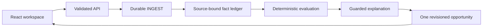

# Tally

Tally helps a small-business owner turn scattered records into an evidence-backed next step. The demonstration follows **Juniper Lane Bakery LLC** and one potential **2025 federal small-business health insurance credit** opportunity. It keeps source evidence, unresolved questions and the next action together.

The **Rule library** contains ten distinct 2025 federal opportunities: five credits and five deductions, with official IRS sources, claimant scope and missing evidence. Nine have offline profile screening only; the health credit retains the tested two-document fixture flow. All remain professionally unreviewed, live E2E is unverified, and screening does not activate a claim or calculate savings. See the [versioned library](rules/2025/opportunity-library.json) and [deterministic screening](packages/rules/library.ts).

**Current delivery:** a runnable local product with synthetic records and a verified offline fixture flow. The user-selected explanation target is **OpenRouter `openai/gpt-6-luna`**; its isolated A/B run passed both accepted explanations and all ten browser checks. Verification of the main checkout’s integrated runtime and any new recording remain pending. One actual Box upload/extraction and a deployed disabled AWS stack provide separate partial evidence. Full Box → AWS → explanation → page E2E is **not proven**. No eligibility decision or credit estimate is produced from these partial records.

## Try the product

Prerequisite: Node.js **22.13 or newer, below 25**, with npm. The project pins Node **22.23.3** as a local development dependency; verification uses that runtime.

```sh
npm ci
TALLY_EXECUTION_MODE=fixture TALLY_OPENROUTER_ENABLED=false \
LIVE_PROVIDERS_ENABLED=false TALLY_APPROVED_LIVE_FLOW=false npm run dev
```

Open **http://127.0.0.1:5173**. The API listens on **http://127.0.0.1:4318**. Both bind to loopback. Fixture mode needs no credentials and makes no Box, Bedrock or other provider calls.

1. In **Settings → Business profile**, save the sample business context.
2. In **Settings → Sample workspace**, add **Payment & payroll sample**.
3. Read the priority in **Overview**, inspect **Documents**, and open the opportunity's **Evidence** tab.
4. Add **Coverage statement sample** from Settings. The **same opportunity** updates with coverage and a stated **80% monthly employer premium share**.
5. Open **Annual review**. All **eight requirements remain Unknown**; payment-to-coverage matching remains unresolved and no estimate appears.
6. Refresh the page. The local state persists.

See [the product walkthrough](docs/demo.md) and [redesign review artifacts](docs/redesign-review.md). Sample controls are intentionally confined to Settings.

## State and configuration

The default store is `.data/state.json`. Preserve it when checking another flow. Set `TALLY_DATA_PATH` to a fresh path for an independent session; do not delete working data to reset a test.

The server does **not** automatically load a `.env` file. Pass settings through the process environment. [.env.example](.env.example) documents the available non-secret settings and the separate live gates.

| Setting | Fixture default | Purpose |
| --- | --- | --- |
| `TALLY_EXECUTION_MODE` | `fixture` | Local fixture backend; `aws` selects the approved signed upstream |
| `TALLY_OPENROUTER_ENABLED` | `false` | Explicit opt-in to metered local fixture explanations |
| `TALLY_DATA_PATH` | `.data/state.json` | Local JSON state only |
| `TALLY_LOCAL_PORT` | `4318` | Loopback API |
| `TALLY_WEB_PORT` | `5173` | Vite port, fails if occupied |
| `TALLY_WEB_ORIGIN` | `http://127.0.0.1:5173` | Allowed local web origin |
| `TALLY_API_PROXY_TARGET` | `http://127.0.0.1:4318` | Vite's loopback API target |

Credentials never belong in frontend code, committed files, screenshots or chat. The AWS path uses a server-side IAM signer and approved Secrets Manager references.

## Verify locally

```sh
npm run typecheck
npm test
npm run build
npm run check:infra
```

The redesign baseline passed 126 offline tests and real Chromium fixture checks. Current readiness verification includes preparation failure/recovery, extraction-lease concurrency, infrastructure gates and the offline evidence validator; results are recorded in the [verification matrix](docs/verification-matrix.md). TypeScript and the production build passed. Mocked tests do not certify provider access.

The unit suite blocks external networking. The browser journey also blocks external requests and refuses a nonempty or non-fixture starting state. To run it beside the working app, use two terminals:

```sh
# Terminal 1: preserve the default working state and ports.
TALLY_QA_DIR=$(mktemp -d /tmp/tally-qa.XXXXXX)
TALLY_EXECUTION_MODE=fixture TALLY_OPENROUTER_ENABLED=false \
LIVE_PROVIDERS_ENABLED=false TALLY_APPROVED_LIVE_FLOW=false \
TALLY_DATA_PATH="$TALLY_QA_DIR/state.json" TALLY_LOCAL_PORT=4324 \
TALLY_WEB_PORT=5177 TALLY_WEB_ORIGIN=http://127.0.0.1:5177 \
TALLY_API_PROXY_TARGET=http://127.0.0.1:4324 npm run dev
```

```sh
# Terminal 2
TALLY_WEB_URL=http://127.0.0.1:5177 TALLY_API_URL=http://127.0.0.1:4324 \
TALLY_ARTIFACTS_DIR=.artifacts/browser-check npm run test:browser
```

If Chromium is absent, install the official Playwright browser with `npx playwright install chromium`. Stop the isolated server with Ctrl-C after the check. Screenshots and manifests are ignored under `.artifacts/`; production build output is `dist/web/`.

## How it works



Fixture mode uses a local JSON store and local jobs. The implemented AWS path uses an IAM-authenticated API, signature-checked Box webhook, SQS, DynamoDB and Box structured extraction. Its reviewed stack is deployed with both live gates false; full application data flow remains unverified. The selected new explanation path is server-side OpenRouter `openai/gpt-6-luna`, with isolated fixture-backed A/B acceptance verified and main-checkout integration checks pending. Earlier Strands/Bedrock probes are historical provider evidence, not the selected demo path.

The deterministic evaluator owns statuses, facts, calculations, annual unknowns and next actions. AI can explain a valid result; it cannot decide eligibility, invent evidence or supply an unsupported amount. Read [architecture and data flow](docs/architecture.md).

## Verification and integration status

| Area | Observed result | Limit |
| --- | --- | --- |
| Local fixture product | Profile → A → same-card B, 80% monthly share, source links, eight annual Unknowns, refresh/restart and recovery verified | Synthetic fixture extraction; no annual eligibility or estimate |
| Actual Box test | One upload HTTP201 and one 18-field extraction HTTP200; six observed values matched the synthetic source | Zero accepted citations in the saved projection; `$` does not prove USD; full source-supported normalization is unverified |
| AWS | Reviewed disabled stack CREATE_COMPLETE with 17 resources; Lambda/SQS/DynamoDB/API infrastructure and separate private S3 artifacts exist | Both live gates false; infrastructure and successful ARM64 packaging probes do not prove application E2E |
| Selected explanations | Isolated OpenRouter `openai/gpt-6-luna` A/B: **2/2 accepted**, HTTP200/stop, observed provider OpenAI; all ten browser checks passed at source `5bb11db` | Fixture intake/extraction plus real explanations; main-checkout integration checks pending. Final pair USD 0.0007823; cumulative eight-call provider ledger USD 0.0029223 |
| Demo recording | Verified baseline `.artifacts/redesign-demo/tally-redesign-demo.mp4`, **84.24s** | Baseline is fixture-only. The isolated real-explanation verification created no recording; no new live video is claimed |
| Full Box/AWS application journey | **NOT PROVEN** | No claim of genuine webhook → worker → accepted facts → current model explanation → UI success |

The AWS deployment has no newly deployed OpenRouter credential or OpenRouter-specific runtime wiring. Do not enable cloud gates to try a local demo. The [organizer page](https://luma.com/bqo9xii4) asks projects to use Box and AWS; no Bedrock-only requirement was found in the reviewed rules. These facts do **not** certify event compliance or judge acceptance.

[Provider evidence](docs/providers.md), [deployment runbook](docs/deployment.md) and [verification matrix](docs/verification-matrix.md) retain the detailed boundaries. The USD 10 total deployment/test ceiling excludes Box purchases; provider activity must stay within its explicit approved scope.

## Optional OpenRouter demonstration

The selected exact target is `openai/gpt-6-luna`, selected by `TALLY_EXPLANATION_ADAPTER=openrouter`; `TALLY_OPENROUTER_ENABLED=false` is the offline default. The integrated command below is under final runtime verification. It opts into metered explanations for fixture intake only and does not enable deployed AWS gates.

Set `OPENROUTER_PRIOR_SPEND_USD` in the server environment to the verified cumulative prior spend before starting; do not reset it to zero to reuse a budget. With the already approved credential file in place:

```sh
TALLY_DEMO_DIR=$(mktemp -d /tmp/tally-openrouter-demo.XXXXXX)
TALLY_EXECUTION_MODE=fixture TALLY_OPENROUTER_ENABLED=true \
TALLY_EXPLANATION_ADAPTER=openrouter OPENROUTER_MODEL_ID=openai/gpt-6-luna \
LIVE_PROVIDERS_ENABLED=false TALLY_APPROVED_LIVE_FLOW=false \
TALLY_DATA_PATH="$TALLY_DEMO_DIR/state.json" TALLY_LOCAL_PORT=4324 \
TALLY_WEB_PORT=5177 TALLY_WEB_ORIGIN=http://127.0.0.1:5177 \
TALLY_API_PROXY_TARGET=http://127.0.0.1:4324 \
node --env-file="$HOME/.config/openrouter/credentials.env" \
  node_modules/tsx/dist/cli.mjs scripts/dev.ts
```

Open `http://127.0.0.1:5177`; stop any earlier isolated pair on those same ports first. Use Node 22 as required above. The server parent loads the credential file; the Vite child filters provider variables. Load an already approved credential only through this normal server-side environment/Node `--env-file` path. Never pass a key in a command argument, copy it into this repository or expose it to Vite/browser code. Use a fresh isolated `TALLY_DATA_PATH`: startup may resume pending jobs. An accepted real explanation must have a truthful OpenRouter receipt/UI label; deterministic fallback must remain labeled fallback. Fixture extraction plus a real explanation is a **hybrid demonstration**, not a live Box/AWS E2E.

## Evidence and fixture provenance

The original `tally-build-handoff.zip`, exact contracts and original PDFs were **not obtained or read**. Current contracts, rules/goldens and `fixtures/interim/` were reconstructed from the supplied written prompt and Google Doc sections 18–19, and are explicitly labeled synthetic/interim. Original parity remains pending.

Sample A records a $1,200 insurance payment and partial June payroll; sample B states $1,500 total premium, $1,200 employer and $300 employee contributions. Equal amounts do not prove a payment match. Partial payroll does not resolve full-year requirements.

The existing synthetic PDFs lack an explicit USD currency token. Live normalization may therefore retain monetary values as candidates/unknown rather than promote them. Fixture goldens are separate labeled inputs; the PDFs have not been silently rewritten. See [known limits and verification](docs/verification-matrix.md).

## Documentation

- [Architecture and consistency model](docs/architecture.md)
- [Provider gates and source validation](docs/providers.md)
- [Existing secret formats and handling](docs/secrets.md)
- [Packaging and platform limits](docs/packaging.md)
- [Secure deployment and cleanup runbook](docs/deployment.md)
- [Live E2E plan](docs/live-e2e.md) and [verification matrix](docs/verification-matrix.md)
- [Cost assumptions and exact approval boundaries](docs/costs-and-approvals.md)
- [Three-minute English demo script](docs/demo-script.md) and [submission checklist](docs/submission-checklist.md)

Repository visibility, the reviewed source commit, judge access, submission destination and shareable video URL must be checked at handoff. A code push is not a hackathon submission. No publication, visibility change or submission is performed by these instructions.
