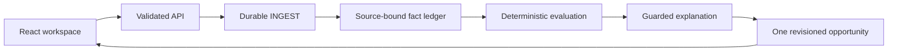

# Tally

Tally helps a small-business owner turn scattered records into an evidence-backed next step. The demonstration follows **Juniper Lane Bakery LLC** and one potential **2025 federal small-business health insurance credit** opportunity. It keeps source evidence, unresolved questions and the next action together.

The **Rule library** contains ten distinct 2025 federal opportunities: five credits and five deductions, with official IRS sources, claimant scope and missing evidence. Nine have offline profile screening only; the health credit retains the tested two-document fixture flow. All remain professionally unreviewed, live E2E is unverified, and screening does not activate a claim or calculate savings. See the [versioned library](rules/2025/opportunity-library.json) and [deterministic screening](packages/rules/library.ts).

**Current delivery:** a runnable local product with synthetic records and a verified offline fixture flow. The user-selected explanation target is **OpenRouter `openai/gpt-6-luna`**; its isolated A/B run passed both accepted explanations and all ten browser checks. The verified public remote baseline is `0532e0a`; its integrated source checkpoint `bdb578f9` passed 288/288 offline tests plus TypeScript/build/infra. The opt-in local PDF path has passed its first actual-A offline full application replay. Frozen local source `185a4cca` passed 305/305 offline tests plus TypeScript, Vite build and infrastructure checks; this is separate from that earlier public baseline. A later approved A-only continuation verified eight local PDF facts, but its one new real Luna response triggered the explanation guard and deterministic fallback; it stopped before retry/B. The selective publication snapshot passed 305 tests; the broader continuation worktree passed 323, with unrelated confidence/secret edits excluded from publication. A 119.32s backup presentation recording is ready and saved to Library, with persistent fixture/saved-real-Luna disclosure; no main live E2E pass is claimed. The historical interim-B and new explicit-USD-A Box tests, plus a deployed disabled AWS stack, provide separate partial evidence. Full Box → AWS → explanation → page E2E is **not proven**. No eligibility decision or credit estimate is produced from these partial records.

## Try the product

Prerequisite: Node.js **22.13 or newer, below 25**, with npm. The project pins Node **22.23.3** as a local development dependency; verification uses that runtime.

```sh
npm ci
TALLY_EXECUTION_MODE=fixture TALLY_OPENROUTER_ENABLED=false \
LIVE_PROVIDERS_ENABLED=false TALLY_APPROVED_LIVE_FLOW=false npm run dev
```

Open **http://127.0.0.1:5173**. The API listens on **http://127.0.0.1:4318**. Both bind to loopback. Fixture mode needs no credentials and makes no Box, Bedrock or other provider calls.

1. In **Settings → Business profile**, save the sample business context.
2. In **Settings → Sample workspace**, add **Payment & payroll sample**.
3. Read the priority in **Overview**, inspect **Documents**, and open the opportunity's **Evidence** tab.
4. Add **Coverage statement sample** from Settings. The **same opportunity** updates with coverage and a stated **80% monthly employer premium share**.
5. Open **Annual review**. All **eight requirements remain Unknown**; payment-to-coverage matching remains unresolved and no estimate appears.
6. Refresh the page. The local state persists.

See [the product walkthrough](docs/demo.md) and [redesign review artifacts](docs/redesign-review.md). Sample controls are intentionally confined to Settings.

## State and configuration

The default store is `.data/state.json`. Preserve it when checking another flow. Set `TALLY_DATA_PATH` to a fresh path for an independent session; do not delete working data to reset a test.

The server does **not** automatically load a `.env` file. Pass settings through the process environment. [.env.example](.env.example) documents the available non-secret settings and the separate live gates.

| Setting | Fixture default | Purpose |
| --- | --- | --- |
| `TALLY_EXECUTION_MODE` | `fixture` | Local fixture backend; `aws` selects the approved signed upstream |
| `TALLY_OPENROUTER_ENABLED` | `false` | Explicit opt-in to metered local fixture explanations |
| `TALLY_DATA_PATH` | `.data/state.json` | Local JSON state only |
| `TALLY_LOCAL_PORT` | `4318` | Loopback API |
| `TALLY_WEB_PORT` | `5173` | Vite port, fails if occupied |
| `TALLY_WEB_ORIGIN` | `http://127.0.0.1:5173` | Allowed local web origin |
| `TALLY_API_PROXY_TARGET` | `http://127.0.0.1:4318` | Vite's loopback API target |

Credentials never belong in frontend code, committed files, screenshots or chat. The AWS path uses a server-side IAM signer and approved Secrets Manager references.

## Verify locally

```sh
npm run typecheck
npm test
npm run build
npm run check:infra
```

The selective snapshot prepared for publication passed **305/305 offline tests**, TypeScript and Vite production build. The earlier frozen local source `185a4cca` also passed infrastructure checks. The broader reviewed worktree passed **323/323 offline tests**, TypeScript and Vite build; it includes unrelated confidence/secret edits excluded from the publication snapshot. The approved A-only continuation ran on that broader worktree. These are distinct local verification scopes, not a main live E2E pass. Historical redesign/fixture receipts remain in the [verification matrix](docs/verification-matrix.md). Offline checks do not certify accepted Box references or cloud application processing.

The unit suite blocks external networking. The browser journey also blocks external requests and refuses a nonempty or non-fixture starting state. To run it beside the working app, use two terminals:

```sh
# Terminal 1: preserve the default working state and ports.
TALLY_QA_DIR=$(mktemp -d /tmp/tally-qa.XXXXXX)
TALLY_EXECUTION_MODE=fixture TALLY_OPENROUTER_ENABLED=false \
LIVE_PROVIDERS_ENABLED=false TALLY_APPROVED_LIVE_FLOW=false \
TALLY_DATA_PATH="$TALLY_QA_DIR/state.json" TALLY_LOCAL_PORT=4324 \
TALLY_WEB_PORT=5177 TALLY_WEB_ORIGIN=http://127.0.0.1:5177 \
TALLY_API_PROXY_TARGET=http://127.0.0.1:4324 npm run dev
```

```sh
# Terminal 2
TALLY_WEB_URL=http://127.0.0.1:5177 TALLY_API_URL=http://127.0.0.1:4324 \
TALLY_ARTIFACTS_DIR=.artifacts/browser-check npm run test:browser
```

If Chromium is absent, install the official Playwright browser with `npx playwright install chromium`. Stop the isolated server with Ctrl-C after the check. Screenshots and manifests are ignored under `.artifacts/`; production build output is `dist/web/`.

## How it works



Fixture mode uses a local JSON store and local jobs. The implemented AWS path uses an IAM-authenticated API, signature-checked Box webhook, SQS, DynamoDB and Box structured extraction. Its reviewed stack is deployed with both live gates false; full application data flow remains unverified. The selected new explanation path is server-side OpenRouter `openai/gpt-6-luna`, with isolated fixture-backed A/B acceptance verified and frozen local source `185a4cca` passed 305/305 offline tests plus TypeScript/Vite build/infra; no main live E2E pass. Earlier Strands/Bedrock probes are historical provider evidence, not the selected demo path.

The deterministic evaluator owns statuses, facts, calculations, annual unknowns and next actions. AI can explain a valid result; it cannot decide eligibility, invent evidence or supply an unsupported amount. Read [architecture and data flow](docs/architecture.md).

## Verification and integration status

| Area | Observed result | Limit |
| --- | --- | --- |
| Local fixture product | Profile → A → same-card B, 80% monthly share, source links, eight annual Unknowns, refresh/restart and recovery verified | Synthetic fixture extraction; no annual eligibility or estimate |
| Historical interim-B Box test | One upload HTTP201 and one 18-field extraction HTTP200; six observed values matched | Zero accepted citations; `$` does not prove USD. Distinct from the later USD-A test |
| First USD-A attempt (historical) | One upload HTTP201; one completed extraction response; file/version/hash binding passed | Exact extraction HTTP status/request ID not retained. All 8 references rejected `reference_unexpected_keys`; 8 confidence objects→null; 0 accepted facts/citations at the stop; later renewed A1 is recorded below |
| Renewed USD-A1 native-reference test | HTTP200 at 19:27:59 UTC; eight fields/ten reference objects all lacked own `item_id` | 0 accepted native citations/facts; no Luna/B. USD-series total 1 upload/2 extractions, cap 3; exact IDs private |
| Approved A-only continuation | Current A metadata/version/download hash passed; 8/8 local PDF proofs; one Luna HTTP200, 4390 input/551 output tokens, USD 0.0007145 | `EXPLANATION_CLAIM` / `eligibility_or_annual_claim` → deterministic fallback. Stopped: no retry/B/new Box AI/upload; same card revision 1, needs coverage, annual/payment Unknown and no estimate. Nine-call cumulative Luna cost USD 0.0036368 |
| AWS | Reviewed disabled stack CREATE_COMPLETE with 17 resources; Lambda/SQS/DynamoDB/API infrastructure and separate private S3 artifacts exist | Both live gates false; infrastructure and successful ARM64 packaging probes do not prove application E2E |
| Selected explanations | Isolated OpenRouter `openai/gpt-6-luna` A/B: **2/2 accepted**, HTTP200/stop, observed provider OpenAI; all ten browser checks passed at source `5bb11db` | Fixture intake/extraction plus real explanations; frozen local source `185a4cca` passed 305/305 offline tests plus TypeScript/Vite build/infra; no main live E2E pass. Final isolated pair USD 0.0007823; historical eight-call ledger USD 0.0029223; latest cumulative nine-call ledger USD 0.0036368 |
| Recording | **119.32s** backup presentation recording ready and saved to Library; verified **84.24s** fixture baseline unchanged; separate **31.8s** actual A-attempt clip private | Backup persistently discloses fixture extraction/saved real Luna explanations. Neither it nor the A-only clip proves full Box/AWS E2E |
| Full Box/AWS application journey | **NOT PROVEN** | No claim of genuine webhook → worker → accepted facts → current model explanation → UI success |

The AWS deployment has no newly deployed OpenRouter credential or OpenRouter-specific runtime wiring. Do not enable cloud gates to try a local demo. The [organizer page](https://luma.com/bqo9xii4) asks projects to use Box and AWS; no Bedrock-only requirement was found in the reviewed rules. These facts do **not** certify event compliance or judge acceptance.

[Provider evidence](docs/providers.md), [deployment runbook](docs/deployment.md) and [verification matrix](docs/verification-matrix.md) retain the detailed boundaries. The USD 10 total deployment/test ceiling excludes Box purchases; provider activity must stay within its explicit approved scope.

## Opt-in local PDF verification — offline replay passed

`BOX_SOURCE_VERIFICATION=local_pdf_text_match` is an explicit opt-in path in frozen local source `185a4cca`. It independently reads labeled rows from the exact downloaded PDF and compares them with actual Box scalar candidates, bound to the same file/version/SHA-256. Fixture goldens are not source proof. Any resulting fact/UI provenance must say **“PDF text verified locally · Not a native Box citation”**; it must never be described as a native Box citation. The existing native-reference path remains the default, and invalid selectors fail closed. The verifier is limited to narrow English record layouts; ambiguity, conflicts or unsupported layouts remain review. The first actual-A offline full application replay passed: API profile → Analyze → normal production-runtime LiveWorker INGEST/EVALUATE → FileStore settled at `needs_coverage_statement`, with eight locally PDF-verified facts, eight annual Unknowns, payment match Unknown, null contribution share/estimate and deterministic fallback. It used the exact saved Box response and hash-bound uploaded PDF with zero network, secret or model calls. This is a passed offline application replay, separate from native citation proof; frozen local source `185a4cca` passed 305/305 offline tests plus TypeScript/Vite build/infra. Full Box/AWS E2E remains unverified.

## Optional OpenRouter demonstration

The selected exact target is `openai/gpt-6-luna`, selected by `TALLY_EXPLANATION_ADAPTER=openrouter`; `TALLY_OPENROUTER_ENABLED=false` is the offline default. The integrated local wiring passed the 305-test offline suite at frozen local source `185a4cca`; this is not a new main provider-enabled A/B receipt. It opts into metered explanations for fixture intake only and does not enable deployed AWS gates.

Set `OPENROUTER_PRIOR_SPEND_USD` in the server environment to the verified cumulative prior spend before starting; do not reset it to zero to reuse a budget. With the already approved credential file in place:

```sh
TALLY_DEMO_DIR=$(mktemp -d /tmp/tally-openrouter-demo.XXXXXX)
TALLY_EXECUTION_MODE=fixture TALLY_OPENROUTER_ENABLED=true \
TALLY_EXPLANATION_ADAPTER=openrouter OPENROUTER_MODEL_ID=openai/gpt-6-luna \
LIVE_PROVIDERS_ENABLED=false TALLY_APPROVED_LIVE_FLOW=false \
TALLY_DATA_PATH="$TALLY_DEMO_DIR/state.json" TALLY_LOCAL_PORT=4324 \
TALLY_WEB_PORT=5177 TALLY_WEB_ORIGIN=http://127.0.0.1:5177 \
TALLY_API_PROXY_TARGET=http://127.0.0.1:4324 \
node --env-file="$HOME/.config/openrouter/credentials.env" \
  node_modules/tsx/dist/cli.mjs scripts/dev.ts
```

Open `http://127.0.0.1:5177`; stop any earlier isolated pair on those same ports first. Use Node 22 as required above. The server parent loads the credential file; the Vite child filters provider variables. Load an already approved credential only through this normal server-side environment/Node `--env-file` path. Never pass a key in a command argument, copy it into this repository or expose it to Vite/browser code. Use a fresh isolated `TALLY_DATA_PATH`: startup may resume pending jobs. An accepted real explanation must have a truthful OpenRouter receipt/UI label; deterministic fallback must remain labeled fallback. Fixture extraction plus a real explanation is a **hybrid demonstration**, not a live Box/AWS E2E.

## Evidence and fixture provenance

The original `tally-build-handoff.zip`, exact contracts and original PDFs were **not obtained or read**. Current contracts, rules/goldens and `fixtures/interim/` were reconstructed from the supplied written prompt and Google Doc sections 18–19, and are explicitly labeled synthetic/interim. Original parity remains pending.

Sample A records a $1,200 insurance payment and partial June payroll; sample B states $1,500 total premium, $1,200 employer and $300 employee contributions. Equal amounts do not prove a payment match. Partial payroll does not resolve full-year requirements.

The historical `fixtures/interim/` PDFs lack explicit USD and remain unchanged. The separate [fixtures/live-usd provenance addition](fixtures/live-usd/README.md) contains approved reconstructed synthetic USD records with immutable hashes; these are not original handoff documents or an automatic runtime replacement. The two actual USD-A extraction attempts still accepted no native citations/facts. In renewed A1, each reference lacked its own `item_id`; the first attempt’s discarded unexpected-key mapping remains unknown. Explicit currency alone did not establish native citations. Local PDF verification is a separately labeled opt-in method, not a repaired native citation. Fixture goldens remain separate labeled inputs. See [known limits and verification](docs/verification-matrix.md).

## Documentation

- [Architecture and consistency model](docs/architecture.md)
- [Provider gates and source validation](docs/providers.md)
- [Existing secret formats and handling](docs/secrets.md)
- [Packaging and platform limits](docs/packaging.md)
- [Secure deployment and cleanup runbook](docs/deployment.md)
- [Live E2E plan](docs/live-e2e.md) and [verification matrix](docs/verification-matrix.md)
- [Cost assumptions and exact approval boundaries](docs/costs-and-approvals.md)
- [Three-minute English demo script](docs/demo-script.md) and [submission checklist](docs/submission-checklist.md)

Public remote baseline `0532e0a` was verified. Judge access, later source changes and the final presentation URL remain separate handoff details. A code push is not a hackathon submission. No publication, visibility change or submission is performed by these instructions.
