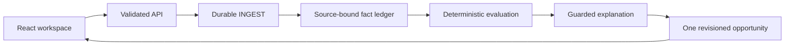

# Tally

Tally helps a small-business owner turn scattered records into an evidence-backed next step. The demonstration follows **Juniper Lane Bakery LLC** and one potential **2025 federal small-business health insurance credit** opportunity. It keeps source evidence, unresolved questions and the next action together.

The **Rule library** contains ten distinct 2025 federal opportunities: five credits and five deductions, with official IRS sources, claimant scope and missing evidence. Nine have offline profile screening only; the health credit retains the tested two-document fixture flow. All remain professionally unreviewed, live E2E is unverified, and screening does not activate a claim or calculate savings. See the [versioned library](rules/2025/opportunity-library.json) and [deterministic screening](packages/rules/library.ts).

**Current delivery:** a runnable, verified local product with synthetic records. Live Box → AWS → page E2E has **not run**. Both available demo videos show fixture execution. No eligibility decision or credit estimate is produced from these partial records.

## Try the product

Prerequisite: Node.js **22.13 or newer, below 25**, with npm. The project pins Node **22.23.3** as a local development dependency; verification uses that runtime.

```sh
npm ci
TALLY_EXECUTION_MODE=fixture LIVE_PROVIDERS_ENABLED=false TALLY_APPROVED_LIVE_FLOW=false npm run dev
```

Open **http://127.0.0.1:5173**. The API listens on **http://127.0.0.1:4318**. Both bind to loopback. Fixture mode needs no credentials and makes no Box, Bedrock or other provider calls.

1. In **Settings → Business profile**, save the sample business context.
2. In **Settings → Sample workspace**, add **Payment & payroll sample**.
3. Read the priority in **Overview**, inspect **Documents**, and open the opportunity's **Evidence** tab.
4. Add **Coverage statement sample** from Settings. The **same opportunity** updates with coverage and a stated **80% monthly employer premium share**.
5. Open **Annual review**. All **eight requirements remain Unknown**; payment-to-coverage matching remains unresolved and no estimate appears.
6. Refresh the page. The local state persists.

See [the product walkthrough](docs/demo.md) and [redesign review artifacts](docs/redesign-review.md). Sample controls are intentionally confined to Settings.

## State and configuration

The default store is `.data/state.json`. Preserve it when checking another flow. Set `TALLY_DATA_PATH` to a fresh path for an independent session; do not delete working data to reset a test.

The server does **not** automatically load a `.env` file. Pass settings through the process environment. [.env.example](.env.example) documents the available non-secret settings and the separate live gates.

| Setting | Fixture default | Purpose |
| --- | --- | --- |
| `TALLY_EXECUTION_MODE` | `fixture` | Local fixture backend; `aws` selects the approved signed upstream |
| `TALLY_DATA_PATH` | `.data/state.json` | Local JSON state only |
| `TALLY_LOCAL_PORT` | `4318` | Loopback API |
| `TALLY_WEB_PORT` | `5173` | Vite port, fails if occupied |
| `TALLY_WEB_ORIGIN` | `http://127.0.0.1:5173` | Allowed local web origin |
| `TALLY_API_PROXY_TARGET` | `http://127.0.0.1:4318` | Vite's loopback API target |

Credentials never belong in frontend code, committed files, screenshots or chat. The AWS path uses a server-side IAM signer and approved Secrets Manager references.

## Verify locally

```sh
npm run typecheck
npm test
npm run build
npm run check:infra
```

The redesign baseline passed 126 offline tests and real Chromium fixture checks. Current readiness verification includes preparation failure/recovery, extraction-lease concurrency, infrastructure gates and the offline evidence validator; results are recorded in the [verification matrix](docs/verification-matrix.md). TypeScript and the production build passed. Mocked tests do not certify provider access.

The unit suite blocks external networking. The browser journey also blocks external requests and refuses a nonempty or non-fixture starting state. To run it beside the working app, use two terminals:

```sh
# Terminal 1: preserve the default working state and ports.
TALLY_QA_DIR=$(mktemp -d /tmp/tally-qa.XXXXXX)
TALLY_EXECUTION_MODE=fixture LIVE_PROVIDERS_ENABLED=false TALLY_APPROVED_LIVE_FLOW=false \
TALLY_DATA_PATH="$TALLY_QA_DIR/state.json" TALLY_LOCAL_PORT=4324 \
TALLY_WEB_PORT=5177 TALLY_WEB_ORIGIN=http://127.0.0.1:5177 \
TALLY_API_PROXY_TARGET=http://127.0.0.1:4324 npm run dev
```

```sh
# Terminal 2
TALLY_WEB_URL=http://127.0.0.1:5177 TALLY_API_URL=http://127.0.0.1:4324 \
TALLY_ARTIFACTS_DIR=.artifacts/browser-check npm run test:browser
```

If Chromium is absent, install the official Playwright browser with `npx playwright install chromium`. Stop the isolated server with Ctrl-C after the check. Screenshots and manifests are ignored under `.artifacts/`; production build output is `dist/web/`.

## How it works



Fixture mode uses a local JSON store and local jobs. The implemented AWS path uses an IAM-authenticated API, signature-checked Box webhook, SQS, DynamoDB, Box structured extraction and Strands/Bedrock Luna explanations. These adapters have mocked/offline coverage; the deployed path remains unverified.

The deterministic evaluator owns statuses, facts, calculations, annual unknowns and next actions. AI can explain a valid result; it cannot decide eligibility, invent evidence or supply an unsupported amount. Read [architecture and data flow](docs/architecture.md).

## Real integration status

| Stage | Status |
| --- | --- |
| Local product, fixture A→B, source PDF links and persistence | Verified |
| AWS browser-backed CLI login and STS identity | Existing temporary root session approved for bounded Tally preparation; exact runtime grants and secret setup pending |
| Luna inference-profile metadata in `us-east-1` | ACTIVE; invocation and entitlement remain unverified |
| Box browser session | Observed; dedicated Tally app/folder and extraction entitlement unverified |
| Linux ARM64 SAM build | Not run: SAM CLI absent and Docker daemon unavailable |
| Box upload/webhook/extraction → DynamoDB → Luna → page | **NOT RUN** |
| Final live E2E recording | **NOT RUN**; follows integration, E2E, fixes and retest |

No Tally/Millie-named CloudFormation stacks, Lambda functions or DynamoDB tables were found in the inspected `us-east-1` listing. That is a scoped metadata observation, not a claim about every account resource or region. No deployment, paid provider call, IAM expansion or Box authorization was performed.

[Deployment runbook](docs/deployment.md), [costs and approval boundaries](docs/costs-and-approvals.md), and [live E2E checklist](docs/live-e2e.md) describe the remaining steps. The live flags default false and are configuration guards, not human authorization. A spend limit, exact identities, resource targets and Box entitlement must be established before execution.

## Evidence and fixture provenance

The original `tally-build-handoff.zip`, exact contracts and original PDFs were **not obtained or read**. Current contracts, rules/goldens and `fixtures/interim/` were reconstructed from the supplied written prompt and Google Doc sections 18–19, and are explicitly labeled synthetic/interim. Original parity remains pending.

Sample A records a $1,200 insurance payment and partial June payroll; sample B states $1,500 total premium, $1,200 employer and $300 employee contributions. Equal amounts do not prove a payment match. Partial payroll does not resolve full-year requirements.

The existing synthetic PDFs lack an explicit USD currency token. Live normalization may therefore retain monetary values as candidates/unknown rather than promote them. Fixture goldens are separate labeled inputs; the PDFs have not been silently rewritten. See [known limits and verification](docs/verification-matrix.md).

## Documentation

- [Architecture and consistency model](docs/architecture.md)
- [Provider gates and source validation](docs/providers.md)
- [Existing secret formats and handling](docs/secrets.md)
- [Packaging and platform limits](docs/packaging.md)
- [Secure deployment and cleanup runbook](docs/deployment.md)
- [Live E2E plan](docs/live-e2e.md) and [verification matrix](docs/verification-matrix.md)
- [Cost assumptions and exact approval boundaries](docs/costs-and-approvals.md)
- [Three-minute English demo script](docs/demo-script.md) and [submission checklist](docs/submission-checklist.md)

The repository is private. Judge access, submission form and shareable video URL remain separate review items; pushing source does not publish the product or submit it.
