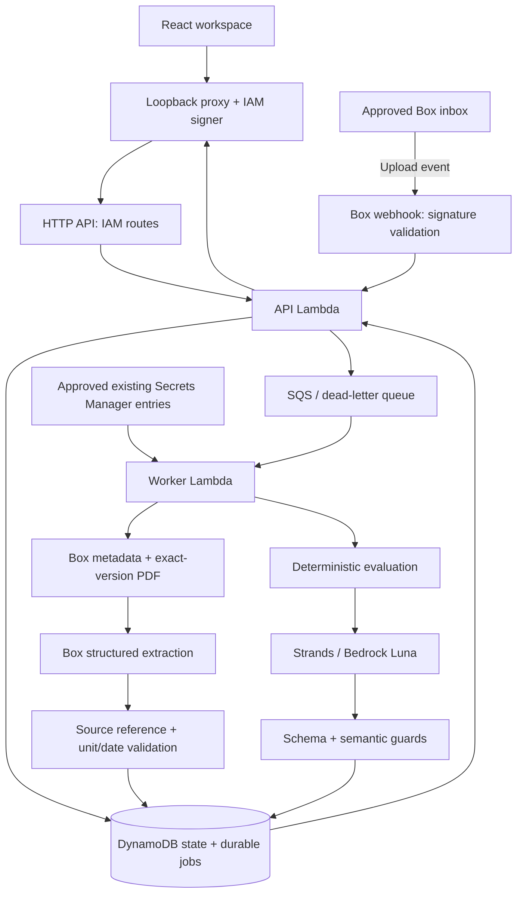

# Tally architecture and data flow

Tally maintains one business, one demonstration tax year and one potential opportunity per rule set. The product shows what the records support, what remains unknown and what to do next. It does not determine annual eligibility or calculate a credit from the partial sample records.

## Execution modes

| Layer | Fixture mode, verified | AWS path, implemented but not live E2E verified |
| --- | --- | --- |
| Browser | React/Vite on loopback | Same browser UI on loopback |
| API transport | Local validated API | Local server signs four allowlisted routes with SigV4 |
| State | JSON FileStore | DynamoDB aggregate with strong reads and conditional writes |
| Work delivery | Persisted local jobs, asynchronous drain | API → SQS → separate INGEST/EVALUATE worker deliveries |
| Extraction | Labeled reconstructed goldens | Box metadata, bounded versioned PDF download, Box structured extraction |
| Explanation | Fixture or deterministic fallback | Strands → Bedrock Luna → local validation/fallback |

The local proxy accepts only the configured loopback host/origin, rejects query selectors and oversized requests, and forwards only `GET /api/state`, `PUT /api/profile`, `POST /api/demo/analyze` and `POST /api/demo/reconcile`. AWS credentials remain server-side. The cloud API uses AWS_IAM for these routes; only the separate Box webhook route is publicly reachable, protected by its raw-body signature checks.

## Intended cloud flow

The following diagram describes implemented boundaries, not evidence of a deployed service.

A user-approved principal must sign the local API requests. Lambda execution roles are not a local developer identity. The reviewed local template now supplies the API-side Box credential reference and exact-secret read permission needed by manual Analyze. Deploying these grants still requires specific approval. The webhook intake path can enqueue without Box credentials, but still requires approved configuration and live verification.

## Evidence lifecycle

1. **Business context:** the API validates the fixed sample identity and editable owner context. Profile writes use an expected revision; conflicts return a recoverable error.
2. **Durable intake:** an accepted manual request or authenticated webhook records intake jobs before queue handoff. An acknowledged event must have durable work; queue failure remains retryable.
3. **Preparation without AI:** the worker checks folder/type/version/size, downloads the exact version, computes actual byte hashes and parses PDF page text. Limits are at most **1 MiB and two pages**. Redirects never forward Box authorization.
4. **Observed source and lease:** the newest valid observation is persisted before extraction. A bounded INGEST lease prevents concurrent deliveries from making duplicate extraction calls for the same work.
5. **Extraction and normalization:** Box returns structured fields with references/confidence. Local code checks scalar shape, business, units, real dates, relevant periods and source excerpts against actual parsed pages. Provider confidence alone cannot establish support.
6. **Atomic ledger commit:** source version/hash, canonical content claim, facts and evaluation work commit together. Obsolete results cannot attach facts to a newer source.
7. **Deterministic evaluation:** the evaluator reads a ledger/profile revision pair and determines evidence checks, annual unknowns, the next action and unavailable estimate.
8. **Guarded explanation:** the provider may describe that result. Local schema/semantic checks reject unsupported claims, numbers, rule references or unexpected content. Failure falls back explicitly.
9. **Publication:** a compare-and-set check prevents an obsolete evaluation from replacing a newer card. The prior card is retained in history. The UI hides an old assessment while a current revision is pending.

A permanently unreadable replacement must invalidate affected current support while preserving history and any unchanged, valid alias. This boundary has a focused local regression; see the verification matrix for the final executed test result. Network/provider failures are never presented as a completed live analysis.

## Identity, aliases and revisions

The stable opportunity ID combines business, tax year and rule set. A new source or profile produces a revision of that card rather than another opportunity. The partial samples leave all eight annual requirements Unknown in either upload order.

Identical bytes under different Box file IDs alias one canonical fact set within the configured tenant/schema. They do not double a payment or payroll amount. An unchanged alias can continue to support a canonical fact when its original file changes. Document detail partitions the selected current hash from earlier information.

A source change retires unsupported current facts and derived values while retaining evidence history. A failed unrelated new upload does not invalidate other documents. A delayed older extraction cannot revive evidence after a newer observation. Jobs and evaluation keys make duplicate deliveries and repeated refreshes idempotent.

## Storage and work bounds

`DynamoStore` stores a single demonstration aggregate at `TENANT#demo-bakery-001#STATE`. Strong reads and conditional revision puts implement atomic transactions across documents, fact claims, jobs and card history. Conditional conflicts retry up to eight times; transaction callbacks contain no external side effects.

The aggregate fails explicitly above **300 KiB**, rather than truncating evidence/history. This is a bounded hackathon storage model, not a multi-tenant or unbounded retention design.

The SAM source declares two Lambdas, two IAM roles, one HTTP API, one DynamoDB table, SQS plus DLQ and two log groups. Worker timeout is 120 seconds, queue visibility 720 seconds, batch size one, maximum receives five and maximum/reserved concurrency two. These values constrain concurrent work; they are not a spending cap. Queue polling and retained resources can still cost money when idle.

## Model and safety boundary

The selected application model is **`us.openai.gpt-6-luna`**, invoked through non-streaming Bedrock Converse from `us-east-1`. The US system inference profile references exact model destinations in `us-east-1`, `us-east-2` and `us-west-2`; profile metadata was observed ACTIVE without a model invocation.

Installed Strands 1.21.0 passes native strict JSON schema through the Bedrock request. A new agent uses one turn/attempt, a 350-total-output-token setting and a 20-second overall deadline; there is no automatic paid repair or warm-up call. No unsupported reasoning field or temperature is sent. The documented default reasoning may consume the output budget, and a truncated/fallback result may still be billed.

The model cannot change ledger facts, evidence status, annual requirements, opportunity identity or amounts. A successful SDK response alone does not pass P02: the actual guarded explanation, usage, latency and fallback behavior require approved live observation. Provider receipt usage/reasons are not currently persisted in the card state, so separate sanitized traces are required for a live E2E evidence pack.

## Authentication and secret handling

Box identity must match the approved expected account before document access. The provider accepts an existing approved access token or client-credentials configuration; it does not implement a new OAuth consent/refresh onboarding flow. App creation, grants, scopes and secret transport require their own concrete approval.

`SecretProvider` accepts only exact configured `us-east-1` ARNs and lazy-loads approved `AWSCURRENT` values behind the live gate. Constructing runtime clients does not retrieve secrets or invoke a provider. Rotation and signature verification never expose secret values in receipts.

Webhook verification covers exact raw bytes, timestamp freshness, matched key/signature pairs and timing-safe comparison. No document text, tokens, signed URLs or credential cache belongs in source control, browser bundles, screenshots or routine logs.

## Verification and remaining gaps

The local product, mocked adapters, source normalization, idempotence, concurrency and packaging checks are distinct from actual provider behavior. [The verification matrix](verification-matrix.md) records each status and evidence. [Live E2E](live-e2e.md) requires externally reviewed Box, worker, DynamoDB, Luna and browser traces; API mode strings alone cannot prove a real pipeline.

The original handoff ZIP/contracts/PDFs remain unavailable. Reconstructed interim inputs are explicitly labeled and must be reconciled before claiming exact handoff parity. Existing synthetic PDFs do not explicitly cite USD, so live normalization may retain monetary values as unknown/candidates. They are unchanged.

The user subsequently approved the existing temporary root session for bounded Tally deployment preparation within USD 10 total. Exact runtime IAM grants, persistent secret configuration and Box authorization remain pending separate approval. No live E2E, final live recording, public sharing or submission has occurred. The remaining operational steps and approvals are in the [deployment runbook](deployment.md).
