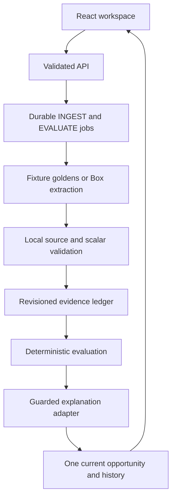

# Tally architecture and data flow

Tally keeps source evidence, open questions and the next action together for one synthetic business and tax year. The Rule library lists ten federal opportunities; nine currently have offline profile screening only. The tested document journey focuses on the 2025 small-business health insurance credit. Screening is not a claim, professional review is pending, and partial records do not determine eligibility or a credit amount.

## Execution boundaries

| Layer | Default fixture path, verified locally | Selected local hybrid path | Deployed AWS path |
| --- | --- | --- | --- |
| Browser | React/Vite on loopback | Same UI with truthful explanation mode | Same UI through signed loopback proxy |
| State/work | FileStore plus durable local jobs | Fresh isolated FileStore/jobs | DynamoDB aggregate plus SQS INGEST/EVALUATE |
| Extraction | Explicitly reconstructed fixture goldens | Still fixture extraction | Box metadata, versioned PDF and structured extraction |
| Explanation | Local sample/deterministic fallback | OpenRouter exact `openai/gpt-6-luna`; isolated A/B accepted, main integration checks pending | Earlier Strands/Bedrock wiring; no OpenRouter credential/wiring deployed |
| Evidence | Actual local browser/HTTP and offline tests | Isolated 2/2 acceptance + ten browser checks; main runtime verification pending | Disabled infrastructure/ARM64 packaging verified; full E2E unproven |

Both deployed live gates remain false. A real OpenRouter response added to fixture facts is a hybrid local flow; it does not establish Box ingestion or AWS application persistence. No key belongs in the frontend. A provider error is an explicitly labeled deterministic fallback, never a silent model switch.

## Pipeline and deployed boundaries

The reviewed AWS stack is CREATE_COMPLETE with 17 resources, including two Linux ARM64 Lambdas, IAM roles, HTTP API, DynamoDB, SQS/DLQ and log groups. A separate private S3 artifact bucket and separately created secret containers are outside the stack. Both immutable ZIPs passed actual Lambda handler/native/PDF probes; original handlers were restored and code hashes stayed unchanged. This is packaging evidence, not a full application run. SAM CLI exists; its container build remains unrun after OrbStack startup was denied.

The loopback proxy signs only four allowlisted API routes. The cloud routes use AWS_IAM; the separate Box webhook route verifies raw-body signature and timestamp before durable intake. API and worker grants are deployed for exact approved targets. Those runtime roles do not become a local developer identity. Genuine webhook delivery, deployed SQS work and DynamoDB application persistence still need correlated live evidence.

## Evidence and consistency

1. Profile writes validate the fixed sample identity, editable context and expected revision.
2. Manual intake or an authenticated webhook persists jobs before queue acknowledgment.
3. Box preparation checks folder/type/version/size, downloads at most 1 MiB/two pages, computes hashes and parses actual page text before extraction. Redirects never forward credentials.
4. A bounded INGEST lease prevents concurrent duplicate extraction for the same work.
5. Local normalization checks scalar shape, units, dates, periods and quoted source excerpts. Provider confidence alone cannot promote support.
6. Source identity, canonical claims, facts and evaluation work commit atomically; obsolete results cannot attach to a newer source.
7. Deterministic evaluation owns document checks, annual Unknowns, opportunity identity, calculations and next action.
8. An explanation adapter may describe that result. Local schema and semantic guards reject unsupported claims, amounts or references, and fall back explicitly.
9. Compare-and-set publication prevents an old evaluation from replacing a newer card. History is retained and stale assessments stay hidden during pending updates.

Identical bytes under different file IDs alias one canonical fact set; they do not double amounts. Source changes retire unsupported current facts while preserving valid aliases and history. An unrelated failed upload does not invalidate other documents. The opportunity ID stays stable across A/B and profile revisions.

`DynamoStore` uses one bounded tenant aggregate with strong reads and conditional writes; conflicts retry up to eight times without side effects inside the transaction callback. State over 300 KiB fails explicitly. The worker timeout is 120 s, SQS visibility 720 s, batch 1 and maximum receives 5. The single SQS event source has maximum concurrency 2; the worker has no reserved concurrency. These are work bounds, not an aggregate spending cap.

## Explanation and rule grounding

The selected delivery target is **OpenRouter `openai/gpt-6-luna`**. An isolated fixture-backed A/B run at source `5bb11db` accepted both actual OpenRouter explanations and passed all ten browser checks. The main checkout’s additional guard/runtime integration checks remain pending; the isolated result is not a current main-build receipt. Do not describe the earlier Luna or Ministral Bedrock configuration as the currently selected explanation provider. The deployed worker retains its earlier configuration until a separately approved deployment; no OpenRouter cloud credential or IAM change is established.

Every accepted explanation must pass the existing four-field schema and local reference/claim checks. It cannot modify facts, annual requirements, opportunity identity or calculations. A successful HTTP response is insufficient. Returned mode and UI label must distinguish real OpenRouter acceptance, sample text and deterministic fallback; no live model rotation is permitted.

The rule context contains selected bounded IRS excerpts, pack/source hashes and provenance. It is not a complete legal engine. Professional review is pending and calculation remains disabled. Source/usage/fallback sidecars must exclude prompts, reasoning, credentials and unredacted transport responses.

## Actual provider evidence and remaining gaps

One real synthetic Box upload returned201 and one structured extraction returned200. Six observed scalar values matched the source, but the saved capture has zero accepted citations and the dollar-only currency text does not establish USD. Endpoint access is separate from accepted source-supported facts. Keep the original interim bytes immutable; fixture goldens remain labeled as fixture input.

The final isolated A/B calls both returned HTTP200/stop from OpenAI and passed the local explanation guards. A used 2474 input/205 output tokens at USD 0.0003499; B used 3124 input/240 output at USD 0.0004324. The final pair cost USD 0.0007823; the eight-call cumulative provider-usage ledger is USD 0.0029223. The ten browser checks covered displayed accepted text, same-card revision, 80%, annual Unknowns, source links, reload, duplicate suppression and mobile/errors. Costs come from provider usage metadata, not an independent invoice. Earlier failures remain historical. The main checkout’s integrated checks are still pending. Existing fixture videos and current local tests likewise cannot certify the full Box → AWS → explanation → page journey. See [provider evidence](providers.md) and [verification matrix](verification-matrix.md).

The original handoff ZIP/contracts/PDFs remain unavailable. No original-file parity, full live E2E, new live recording or event-compliance certification is claimed. The existing verified 84.24-second fixture baseline remains `.artifacts/redesign-demo/tally-redesign-demo.mp4`. Preserve the normal `.data` workspace; use fresh isolated state for any approved hybrid run because startup can drain unfinished jobs.
